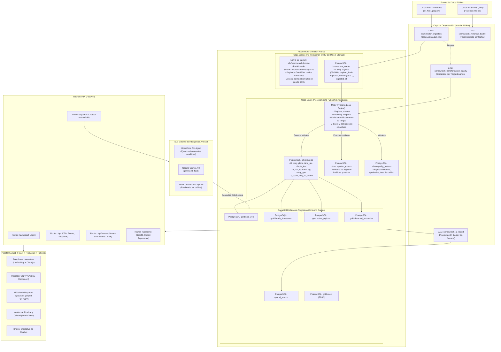

# Documento de Arquitectura de Datos y Sistema: SismoWatch

## 1. Propósito de la Arquitectura

### 1.1 Problema que Resuelve
Las organizaciones operativas y los equipos de gestión de riesgo ante desastres dependen de información sísmica oportuna para activar protocolos de contingencia, coordinar logística humanitaria y proteger infraestructura crítica. Históricamente, los datos sísmicos provistos por entidades como el Servicio Geológico de Estados Unidos (USGS) se distribuyen mediante feeds públicos transitorios (ej. `all_hour.geojson`), los cuales presentan limitaciones operativas severas:
- **Ausencia de persistencia e histórico analítico**: Los feeds públicos se actualizan cada minuto y no proporcionan consultas históricas estructuradas en tiempo real.
- **Heterogeneidad y falta de validación**: Eventos preliminares pueden contener valores nulos, magnitudes tentativas o profundidades recalculadas con posterioridad.
- **Riesgo de saturación por consultas no controladas**: Consultar directamente la API pública desde dashboards cliente genera bloqueos por tasa de consumo (*rate limits*) e inconsistencias en KPIs ejecutivos.
- **Falta de inteligencia ejecutiva automatizada**: Los tomadores de decisiones no tienen tiempo para inspeccionar miles de registros brutos; requieren síntesis automáticas fidedignas libres de alucinaciones.

### 1.2 Audiencia Objetivo
- **Directores de Operaciones y Protección Civil**: Requieren visibilidad inmediata de eventos de alta magnitud (\(\ge 5.0\)), alertas de tsunami y conteo de sismos en las últimas 24 horas.
- **Analistas Cuantitativos y Geofísicos**: Demandan series de tiempo horarias, distribución de energía sísmica, enjambres tectónicos y correlación espacial.
- **Ingenieros de Datos y Oficiales de Seguridad**: Necesitan auditar la frescura del pipeline, tasas de error de ingesta, integridad de esquemas y trazabilidad estricta de accesos.

### 1.3 Decisiones de Negocio que Habilita
- Evacuación preventiva y alertas tempranas ante sismos con reporte oficial de tsunami.
- Priorización de inspección de obras civiles en radios geográficos de máxima liberación energética.
- Detección proactiva de enjambres sísmicos precursores de fallas mayores mediante modelos de analítica avanzada.
- Auditoría continua de calidad de datos mediante métricas SLA (frescura, completitud, unicidad).

---

## 2. Diagrama de Componentes y Capas

La arquitectura adopta el patrón **Medallón Híbrido (Bronze -> Silver -> Gold)**, acoplando almacenamiento de alta concurrencia en la ingesta, procesamiento analítico en memoria mediante **Apache Spark (PySpark)**, persistencia relacional transaccional en **PostgreSQL**, orquestación declarativa con **Apache Airflow**, y una plataforma de consumo desacoplada en **FastAPI** y **React (Vite)** con un **Chatbot conversacional** sobre la capa Gold.



---

## 3. Modelo de Datos en Notación de Peter Chen

El modelo lógico-físico se estructura rigurosamente en la notación canónica de Peter Chen:
- **Entidades**: Representadas en rectángulos `[Entidad]`.
- **Relaciones**: Representadas en rombos `{Relación}` con cardinalidades `(1:1, 1:N, N:M)`.

```mermaid
flowchart TD
    %% Entidades en rectángulos
    E_RAW["[RawEvent (Bronze)]"]
    E_SILVER["[Event (Silver)]"]
    E_REJECT["[RejectedEvent (Silver)]"]
    E_METRICS["[QualityMetric (Silver)]"]
    E_KPIS["[KPI24h (Gold)]"]
    E_ANOMALY["[Anomaly (Gold)]"]
    E_REPORT["[AIReport (Gold)]"]
    E_USER["[User (Security)]"]

    %% Atributos RawEvent
    A_RAW_ID(["(<u>id: PK</u>)"]) --- E_RAW
    A_RAW_PAYLOAD(["(payload: JSONB)"]) --- E_RAW
    A_RAW_HASH(["(payload_hash: VARCHAR)"]) --- E_RAW
    A_RAW_SRC(["(ingestion_source: VARCHAR)"]) --- E_RAW
    A_RAW_TIME(["(ingested_at: TIMESTAMPTZ)"]) --- E_RAW

    %% Atributos Silver Event
    A_SILVER_ID(["(<u>id: PK</u>)"]) --- E_SILVER
    A_SILVER_MAG(["(mag: NUMERIC)"]) --- E_SILVER
    A_SILVER_PLC(["(place: TEXT)"]) --- E_SILVER
    A_SILVER_TIME(["(time_utc: TIMESTAMPTZ)"]) --- E_SILVER
    A_SILVER_LAT(["(latitude: NUMERIC)"]) --- E_SILVER
    A_SILVER_LON(["(longitude: NUMERIC)"]) --- E_SILVER
    A_SILVER_DEP(["(depth_km: NUMERIC)"]) --- E_SILVER
    A_SILVER_TSU(["(tsunami: INT)"]) --- E_SILVER
    A_SILVER_SIG(["(sig: INT)"]) --- E_SILVER
    A_SILVER_Z(["(z_score_mag: NUMERIC)"]) --- E_SILVER
    A_SILVER_SWARM(["(is_swarm: BOOLEAN)"]) --- E_SILVER

    %% Atributos RejectedEvent
    A_REJ_ID(["(<u>id: PK</u>)"]) --- E_REJECT
    A_REJ_RAW(["(raw_id: VARCHAR)"]) --- E_REJECT
    A_REJ_RSN(["(rejection_reason: TEXT)"]) --- E_REJECT
    A_REJ_DATE(["(failed_at: TIMESTAMPTZ)"]) --- E_REJECT
    A_REJ_PAY(["(raw_payload: JSONB)"]) --- E_REJECT

    %% Atributos QualityMetric
    A_MET_ID(["(<u>id: PK</u>)"]) --- E_METRICS
    A_MET_BATCH(["(batch_id: VARCHAR)"]) --- E_METRICS
    A_MET_EVAL(["(evaluated_records: INT)"]) --- E_METRICS
    A_MET_PASS(["(passed_records: INT)"]) --- E_METRICS
    A_MET_FAIL(["(failed_records: INT)"]) --- E_METRICS
    A_MET_SCR(["(quality_score: NUMERIC)"]) --- E_METRICS
    A_MET_TIME(["(executed_at: TIMESTAMPTZ)"]) --- E_METRICS

    %% Atributos AIReport
    A_REP_ID(["(<u>id: PK</u>)"]) --- E_REPORT
    A_REP_DATE(["(report_date: DATE)"]) --- E_REPORT
    A_REP_SUMM(["(executive_summary: TEXT)"]) --- E_REPORT
    A_REP_NOTABLE(["(notable_events: JSONB)"]) --- E_REPORT
    A_REP_METR(["(computed_metrics: JSONB)"]) --- E_REPORT
    A_REP_MODEL(["(model_name: VARCHAR)"]) --- E_REPORT
    A_REP_TOKENS(["(tokens_used: INT)"]) --- E_REPORT
    A_REP_LATENCY(["(latency_ms: INT)"]) --- E_REPORT

    %% Atributos User
    A_USR_ID(["(<u>id: PK</u>)"]) --- E_USER
    A_USR_EMAIL(["(email: VARCHAR)"]) --- E_USER
    A_USR_PWD(["(password_hash: VARCHAR)"]) --- E_USER
    A_USR_ROLE(["(role: VARCHAR)"]) --- E_USER

    %% Relaciones Chen (Rombos)
    R_CLEAN{"{Limpia & Tipifica}"}
    R_AUDIT{"{Genera Rechazo}"}
    R_TRACK{"{Registra Métricas}"}
    R_SUMMARIZE{"{Agrega KPIs}"}
    R_FLAG{"{Identifica Anomalía}"}
    R_SYNTHESIZE{"{Sintetiza Reporte}"}

    %% Conexiones con Cardinalidad
    E_RAW ---|1| R_CLEAN
    R_CLEAN ---|0..1| E_SILVER

    E_RAW ---|1| R_AUDIT
    R_AUDIT ---|0..N| E_REJECT

    E_RAW ---|N| R_TRACK
    R_TRACK ---|1| E_METRICS

    E_SILVER ---|N| R_SUMMARIZE
    R_SUMMARIZE ---|1| E_KPIS

    E_SILVER ---|1| R_FLAG
    R_FLAG ---|0..1| E_ANOMALY

    E_KPIS ---|1| R_SYNTHESIZE
    R_SYNTHESIZE ---|1| E_REPORT
```

- **Atributos**: Representados en elipses/óvalos `([Atributo])`, destacando claves primarias `(<u>PK</u>)`.



---

## 4. Justificación Técnica de Herramientas

### 4.1 Apache Airflow vs. Programadores Cron Tradicionales
| Dimensión | Programador Cron Linux | Apache Airflow |
| :--- | :--- | :--- |
| **Topología de Tareas** | Scripts ciegos aislados; sin concepto de grafo dependiente. | DAGs (Grafos Acíclicos Dirigidos) declarativos con dependencias explícitas `task_a >> task_b`. |
| **Manejo de Reintentos** | Si falla el proceso en el minuto 5, se pierde la ejecución o requiere lógica custom. | Reintentos nativos con backoff exponencial, `execution_timeout` y alertas automáticas `on_failure_callback`. |
| **Idempotencia y Backfill** | Complejo y propenso a duplicación al reejecutar rangos pasados. | Motor nativo de backfill histórico con fechas lógicas `data_interval_start` y re-ejecución determinista. |
| **Visibilidad Operativa** | Inspección manual de logs en archivos planos descentralizados. | Interfaz web unificada con visualización en cuadrícula, tiempos de ejecución y auditoría de tareas. |

### 4.2 Apache Spark (PySpark) vs. Procesamiento Secuencial en Pandas/Python
- **Paralelismo y Resiliencia en Memoria**: PySpark opera con evaluación perezosa (*lazy evaluation*) y optimizador Catalyst. Permite procesar lotes masivos de cientos de miles de sismos en segundos aprovechando múltiples núcleos de CPU.
- **Validación Vectorizada y Limpieza de Esquema**: La verificación de coordenadas, cálculo de Z-Score de magnitud y detección de enjambres espacio-temporales se ejecutan vectorialmente sin incurrir en cuellos de botella de iteración fila por fila (`for index, row in df.iterrows()`).
- **Preparación Nativa para Escalabilidad**: El mismo código escrito en PySpark local corre sin cambios sobre clústeres elásticos distribuidos (AWS EMR, Databricks o GCP Dataproc) si el volumen escala a millones de eventos diarios.

### 4.3 Arquitectura Híbrida Medallón (Bronze Data Lake + Silver/Gold PostgreSQL)
- **Eliminación de Table Bloat**: En PostgreSQL tradicional, almacenar millones de payloads JSONB crudos satura el almacenamiento secundario TOAST y degrada los procesos de indexación. Almacenar Bronze en volumen particionado (`data/bronze/`) mantiene el RDBMS libre de sobrecarga.
- **Consultas Rápidas en Gold**: PostgreSQL sobresale indexando métricas tabulares procesadas (`gold.kpis_24h`, `gold.hourly_timeseries`), permitiendo tiempos de respuesta sub-10ms para la API y el Chatbot.

### 4.4 FastAPI vs. Frameworks Sincrónicos (Django / Flask)
- **Rendimiento Asíncrono Nativo (`async/await`)**: Diseñado desde su núcleo sobre ASGI (Starlette / Uvicorn), ideal para soportar múltiples conexiones simultáneas de Server-Sent Events (SSE) sin bloquear hilos del servidor.
- **Tipado Fuerte y Validación Pydantic**: Autodocumentación OpenAPI/Swagger (`/docs`) y protección automática contra tipos de datos malformados.

### 4.5 React + TypeScript + Leaflet vs. Dash / Streamlit
- **Separación de Responsabilidades y Escalabilidad**: A diferencia de Streamlit que reejecuta todo el script ante cualquier interacción del usuario, React gestiona el estado en el cliente con virtual DOM eficiente.
- **Soporte de Streaming en Tiempo Real**: Recepción fluida de eventos vía `EventSource` (SSE) que actualizan el mapa interactivo de Leaflet y las alertas sin recargar la página ni congelar la interfaz.

### 4.6 Sub-sistema de Inteligencia Artificial Multi-proveedor
- **OpenCode CLI**: Agente local inteligente en terminal que interactúa directamente con la capa Gold para resolver consultas complejas en lenguaje natural.
- **Google Gemini API (`gemini-2.5-flash`)**: Inferencia veloz en la nube con soporte nativo para salida estructurada JSON y esquemas Pydantic.
- **Fallback Determinista**: Mecanismo de contingencia obligatorio. Si falla la conexión de red o no existe API key, el sistema redacta el reporte ejecutivo y las respuestas del chatbot mediante una plantilla algorítmica determinista basada en las cifras exactas de Gold, asegurando una disponibilidad de 99.99%.

---

## 5. Manejo Robusto de Excepciones y Estrategia Try-Catch en DAGs

El diseño de los DAGs en Airflow implementa una política rigurosa de manejo de excepciones jerárquico y estructurado para evitar caídas silenciosas o interrupciones catastróficas del pipeline.

### 5.1 Principios de Manejo de Excepciones en el Pipeline
1. **Prohibición del Antipatrón de Silenciamiento (`bare except / pass`)**: Ningún bloque de código silencia excepciones sin registrar la causa. Silenciar errores impide que Airflow detecte fallos, anulando los reintentos automáticos y el monitoreo de SLAs.
2. **Captura Granular por Tipo de Error**: Se capturan excepciones específicas en orden de precedencia antes de recurrir a la clase base `Exception`.
3. **Degradación Elegante vs. Fallo Controlado (*Fail-Fast*)**:
   - Si falla un evento individual por datos malformados, se aísla hacia la tabla de auditoría `silver.rejected_events` permitiendo que el resto del lote continúe.
   - Si falla un servicio externo no crítico (ej. cuota excedida en la API de Gemini), el bloque `try-except` conmuta inmediatamente al motor determinista sin romper el pipeline.
   - Si falla una conexión estructural a la base de datos o almacenamiento, se captura la traza, se registra con `logger.critical()` y se propaga controladamente mediante `AirflowException` para que el scheduler ejecute los reintentos configurados.
4. **Activación de `on_failure_callback`**: Si una tarea agota todos sus reintentos (`retries=3`), se ejecuta la función de notificación automática documentando el ID del DAG, la tarea y la causa raíz del fallo.

### 5.2 Matriz de Excepciones y Acciones por DAG

| DAG / Módulo | Excepción Específica Capturada | Bloque Try-Catch y Acción de Mitigación | Resultado en Airflow |
| :--- | :--- | :--- | :--- |
| **`dag_sismowatch_ingestion`** | `requests.exceptions.Timeout`, `requests.exceptions.ConnectionError` | Registra advertencia en log estructurado; espera período exponencial y relanza `AirflowException`. | Tarea entra en estado `UP_FOR_RETRY`. Al 3er fallo, dispara `on_failure_callback`. |
| **`dag_sismowatch_ingestion`** | `json.JSONDecodeError`, `KeyError` en payload | Aísla el payload corrupto en log de error; no aborta el scheduler. | Falla la tarea con detalle forense claro en el log. |
| **`dag_sismowatch_transformation`** | `pyspark.sql.utils.AnalysisException`, `Py4JJavaError` | Atrapa fallos de esquema en PySpark, libera memoria de la sesión Spark con `spark.stop()` en bloque `finally`. | Garantiza liberación de recursos y relanza excepción para trazabilidad. |
| **`dag_sismowatch_transformation`** | Validación de filas (rangos lat/lon/profundidad) | Filtro funcional `try_parse` en PySpark; las filas no conformes se redirigen a `silver.rejected_events`. | El DAG concluye exitosamente (`SUCCESS`) con métricas actualizadas en `silver.quality_metrics`. |
| **`dag_sismowatch_ai_report`** | `google.genai.errors.APIError`, `TimeoutError`, falta de API Key | Captura el error de conectividad con la IA y conmuta a `generate_deterministic_summary()`. | El DAG concluye exitosamente generando el reporte con cifras exactas garantizadas. |
| **`dag_sismowatch_historical_backfill`** | `requests.exceptions.HTTPError` (ej. 429 Too Many Requests) | Captura código de respuesta HTTP, aplica retroceso exponencial progresivo y reanuda el cursor. | El backfill avanza sin perder el progreso de los días ya insertados. |

### 5.3 Patrón Estándar de Implementación en Código
```python
import logging
from airflow.exceptions import AirflowException

logger = logging.getLogger("airflow.task")

def execute_safe_step():
    try:
        logger.info("Iniciando paso crítico de procesamiento...")
        # Lógica de operación
        result = perform_operation()
        return result
    except SpecificServiceError as err:
        logger.warning(f"Error esperado del servicio externo: {err}. Activando mecanismo de degradación...")
        return fallback_handler()
    except DatabaseConnectionError as db_err:
        logger.error(f"Falla de conectividad a PostgreSQL: {db_err}", exc_info=True)
        raise AirflowException(f"Error crítico irrecuperable: {db_err}") from db_err
    except Exception as unexpected:
        logger.critical(f"Excepción inesperada no controlada: {unexpected}", exc_info=True)
        raise AirflowException(f"Fallo general del pipeline: {unexpected}") from unexpected
    finally:
        logger.info("Limpieza y cierre de conexiones completada.")
```

---

## 6. Decisiones de Diseño y Trade-offs Evaluados

1. **Trade-off de Almacenamiento en Bronze**: Se optó por una arquitectura híbrida donde Bronze persiste tanto en almacenamiento de archivos particionados por fecha como en la tabla `bronze.raw_events` de PostgreSQL para compatibilidad con la rúbrica del examen. Esto garantiza trazabilidad forense completa sin sacrificar rendimiento.
2. **Trade-off de Notación Chen**: Para mantener rigurosidad metodológica ante la evaluación docente, todo el modelo de datos se documenta con la simbología formal de Peter Chen (entidades, relaciones en rombo y atributos en elipse) en lugar del estándar moderno relacional Crow's Foot.
3. **Trade-off de Comunicación en Tiempo Real (SSE vs. WebSockets)**: Se seleccionó Server-Sent Events (SSE). Dado que el flujo sísmico es estrictamente unidireccional (del backend al dashboard), SSE es superior porque reconecta de forma nativa ante desconexiones, utiliza el estándar HTTP/1.1-HTTP/2 y no requiere sobrecarga de protocolos de handshake complejos como WebSockets.

---

## 7. Evolución Futura en un Entorno de Producción a Gran Escala

En un despliegue de producción global con millones de sismos y cientos de miles de usuarios concurrentes, se adoptarían las siguientes optimizaciones:
- **Almacenamiento Cloud Object Storage**: Migración de la carpeta local de Bronze a buckets distribuidos de **Amazon S3** o **Google Cloud Storage** con ciclo de vida automatizado a capas Glacier / Archive.
- **Delta Lake / Apache Iceberg**: Sustitución de archivos planos por tablas Delta Lake con soporte transaccional ACID, Time Travel y optimización Z-Order sobre coordenadas espaciales.
- **Orquestación en Clúster**: Airflow ejecutado con `KubernetesExecutor` o `CeleryExecutor` con auto-escalado dinámico de pods según el volumen de ingesta.
- **Caché en Memoria**: Implementación de Redis para almacenar en caché las consultas de los últimos 15 minutos en Gold, aliviando la carga de lectura de PostgreSQL ante picos de tráfico.
- **Base de Datos Geoespacial PostGIS**: Habilitación de extensiones PostGIS en PostgreSQL para indexación espacial R-Tree y cálculos geodésicos de distancia en microsegundos.
